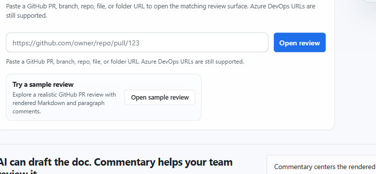

Commentary turns a document, change, or running preview into a place where a team can read the work and discuss it in context. Start with the artifact you already have: a pull request, a branch, a local draft, or a deployed preview.

## Choose your first review

| You have | Start here | Result |
| --- | --- | --- |
| A GitHub or Azure DevOps pull request | [Review a pull request](workflows/review-a-pull-request.md) | A rendered, file-aware review with comments attached to document content |
| A repository document or branch | [Review a branch document](workflows/review-a-branch-document.md) | A clean document view that can be shared before a PR exists |
| Local or generated text not in Git yet | [Review a local draft](workflows/review-a-local-draft.md) | A private review with immutable revisions and Commentary-native threads |
| A running web app | [Review a live preview](workflows/review-a-live-preview.md) | UI feedback tied to selected elements or captured screenshot regions |
| A need to collect structured answers | [Collect answers with a Form](workflows/collect-form-responses.md) | Validated responses attached to a versioned Form Contract |

## Open a public review without signing in

1. Open the [Commentary home page](https://commentary.dev/).
2. Paste a public GitHub pull request URL and select **Open review**.
3. Read in **Preview** and **Document** mode. Use **Raw** to inspect source or **Changes** to compare revisions.
4. Sign in only when you are ready to write, reply, resolve a thread, refresh private content, or submit a provider review.

Public GitHub pull requests support read-only viewing without an account. Private repositories and Azure DevOps require an authorized provider connection. Writing comments, replies, review submissions, and workspace creation also require sign-in.

## What to expect in a review

The rendered document is the main reading surface. A file navigator helps with multi-file changes; the comments pane holds conversations; comparison tools answer focused questions about changed content. You can switch between Preview and Raw without losing the selected revision or comparison.

Threads are anchored to semantic document blocks or selected text. On pull requests, new Commentary threads remain pending until you submit a review. Draft review threads stay in Commentary and do not publish to GitHub or Azure DevOps.

## Sign-in and access

OAuth is the normal sign-in path: GitHub App for GitHub access and Microsoft Entra for Azure DevOps. A personal access token is available as an advanced recovery path for restricted environments. See [choose a sign-in method](start/account-and-access.md).

After signing in, **Workspace** opens Reviews. **Inbox** is a separate account-level destination for requests across workspaces. Projects and Trackers live under Coordinate; Research studies, Forms, and Knowledge live under Research & knowledge.

## Explore safely

- Read the [public launch-readiness review](https://commentary.dev/review/github/commentary-dev/commentary-demo-reviews/pull/1?file=docs%2Flaunch-readiness.md), then follow the [PR walkthrough](workflows/review-a-pull-request.md).
- Try [draft review](workflows/review-a-local-draft.md) when content is not in Git yet.
- Use [Live Preview Reviews](workflows/review-a-live-preview.md) for a browser preview you own or are authorized to review.
- Browse [all task guides](use.md) or [end-to-end workflows](workflows/index.md).

