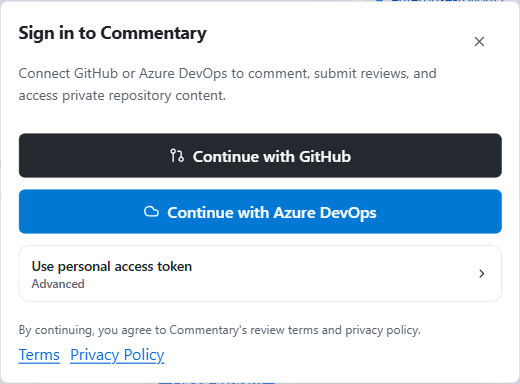

Use an account when you need to write, reach private provider data, or create workspace objects. Public GitHub pull requests remain readable without signing in.

## Choose your sign-in route

1. Open Commentary and choose **Sign in**.
2. For GitHub, choose the GitHub App flow. This is the default and keeps repository authorization explicit.
3. For Azure DevOps, choose Microsoft Entra and authorize the organization you need.
4. Use a personal access token only when OAuth is unavailable in your environment. Treat PAT entry as an advanced recovery option.

The provider connection determines which repositories or organizations Commentary can access. It does not replace workspace membership or agent grants; each is checked separately.

For Azure setup and provider-specific recovery, see [connect Azure DevOps](azure-devops.md).

## Actions that need an account

Sign in to add or reply to a thread, resolve or reopen comments, submit a review, access private content, refresh private data, create or share drafts, manage Forms, create Live Preview Reviews, or use developer access. Workspace features such as Projects, Trackers, Research, and Knowledge also operate in an authenticated workspace.

For CLI, API, and MCP automation, create a scoped Commentary API token in **Developer access**. Keep it in a secret manager or environment variable; do not put it in project metadata or commit it. The CLI stores authentication outside `.commentary/session.json`.

## Grant only the needed repository access

When a provider asks which repositories or organizations Commentary may use, select the scope required for the review. If a repository is missing later, check the provider installation or organization authorization before changing application settings. Commentary still enforces provider and repository access at its server boundary.

## GitHub PAT recovery path

Use a PAT only if the GitHub App or OAuth flow cannot be used. Create a token with the minimum repository permissions needed for your task, copy it once, and enter it through the advanced provider setup. Revoke it from GitHub when it is no longer needed. See [create a GitHub PAT](github-pat.md) for the current screens and permission mapping.

## If access fails

- **Public PR opens, but private PR does not:** sign in and confirm the GitHub App installation includes that repository.
- **Azure project is not listed:** confirm the Entra account and organization access, then retry the connection.
- **You can read but cannot comment:** sign in; read access does not imply write access.
- **An agent can read an object but cannot act:** check the agent grant and the underlying provider or workspace permission independently.

Continue with [the first PR review](../workflows/review-a-pull-request.md), or configure [developer access](../build/developer-access.md) for automation.
