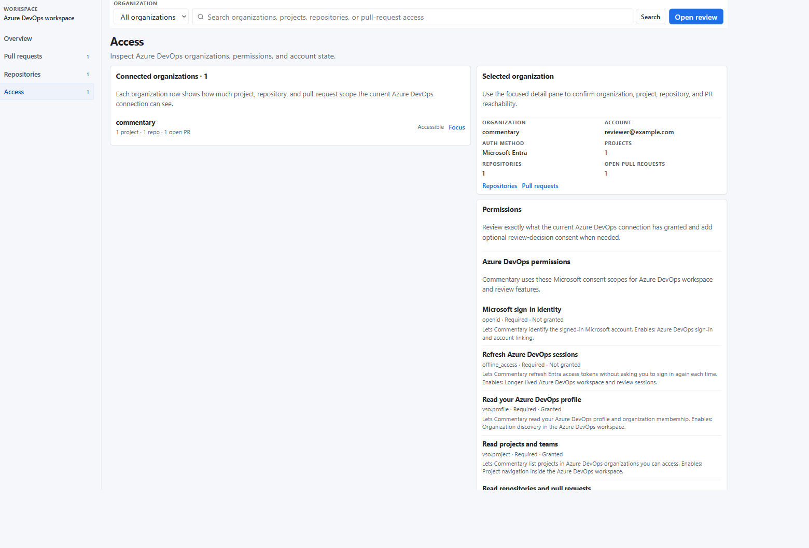
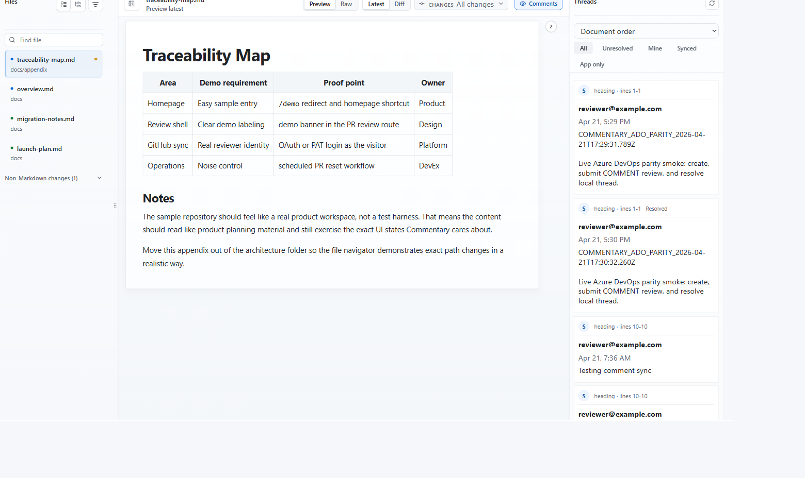

Commentary supports Azure DevOps pull request and direct document reviews. Microsoft Entra is the default connection. Use an Azure DevOps personal access token only when Entra sign-in is unavailable in your environment.

## Connect your organization

1. Sign in to Commentary and choose **Continue with Azure DevOps**.
2. Use the Microsoft account that can access the target organization and project.
3. Review the requested provider scopes and approve the consent needed for the task.
4. Open Workspace and confirm that the intended organization, project, and repository appear.

The workspace can show accessible organizations, projects/repositories, active pull requests, recent Commentary review sessions, and permission state. Provider access remains separate from Commentary workspace membership and agent grants.

## Open a PR or document

Paste an Azure DevOps PR, repository, branch, folder, or Markdown-file URL into the homepage or **Open review**. Prefer a project-scoped URL because it identifies the organization, project, and repository unambiguously. PR reviews use the same document-first shell: read rendered content, switch to Raw for source, use Changes for an intentional range, add comments, and submit the provider review when ready.

Direct branch and document reviews use app-native Commentary threads and do not submit an Azure DevOps PR review event.

## Recover access

- **The URL does not resolve:** use a project-scoped link and confirm the organization/project/repository names.
- **The repository list is empty:** check which Microsoft account is connected and its organization membership.
- **The workspace says permission is missing:** reopen the access page and inspect the granted scopes; request only the required provider consent.
- **A PAT is required:** generate it using Azure DevOps' current token interface, minimum required access and a short expiry. Store it securely and revoke it after recovery.

Azure DevOps provider permissions still apply to refresh and submission. Commentary does not grant Azure source access through a workspace link. Continue with [PR review](../workflows/review-a-pull-request.md) or [branch review](../workflows/review-a-branch-document.md).
