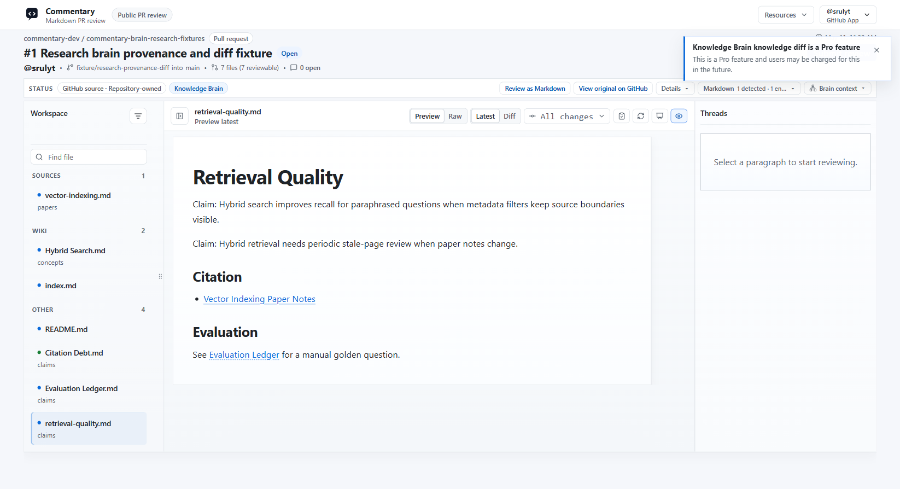

Knowledge Brain review adds brain-aware navigation to the ordinary document review shell. Use it for source notes, generated wiki pages, research claims, project memory, or an Open Knowledge Format bundle that should be reviewed together.

## Inspect a knowledge update

1. Open the repository or branch review and inspect the navigator groups for sources, wiki pages, outputs, and control/support files.
2. For an Open Knowledge Format profile, inspect concept, index, and log groups and the bundle-root concept links.
3. Read changed pages and follow wikilinks and backlinks. Compare generated claims to their source trail.
4. Review health findings such as broken links, missing citations, duplicate entities, schema issues, risky content, and OKF conformance.
5. Check knowledge diffs, graph context, and evaluation ledgers where the repository uses them. Treat automated findings as signals for review, not proof that a claim is true.

Comments remain attached to the relevant source or generated document block. A PR review can be submitted through the provider workflow; branch review comments stay in Commentary. Public Brain readers are read-only and do not expose private comments or review data. Private publishing requires sign-in.

Some advanced Brain surfaces are Pro preview; the OKF review profile is Free. Continue with [the full knowledge update workflow](../workflows/review-a-knowledge-update.md) or [Forms and Knowledge](forms-and-knowledge.md).
