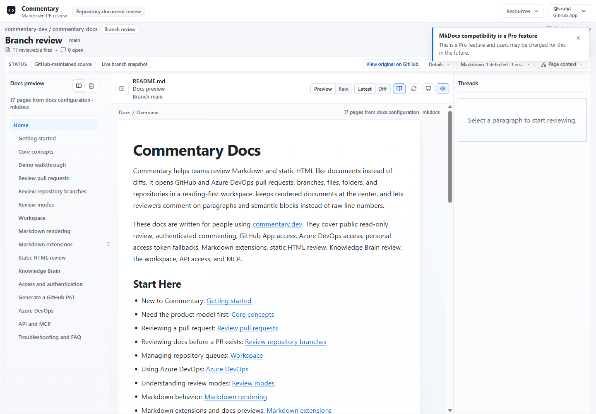
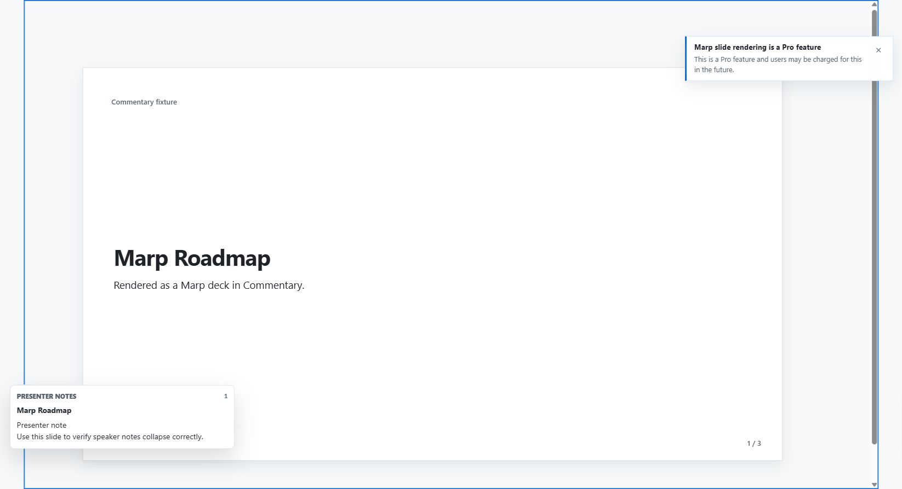

Commentary renders GitHub-flavored Markdown first, then adds compatibility for documentation systems and AI-generated docs that need repository context. Semantic block anchors let comments attach to paragraphs, table rows, and other document content rather than only a raw line number. When source changes, Commentary re-anchors using block identity, line context, selected text, and neighboring text.

## Markdown and MDX

Supported content includes headings, paragraphs, blockquotes, ordered/unordered lists, tables, task lists, fenced/inline code, footnotes, GitHub callouts, and front matter rendered as reviewable metadata. Mermaid has a readable source fallback when rendering fails. Wikilinks show backlinks and unresolved links as readable text. Relative repository links and images resolve inside the current review when they point to another reviewable file.

Markdown embeds can include source-backed Commentary Forms and supported transclusion blocks. Safe MDX placeholders preserve import/export/custom-component context without executing arbitrary customer code. Safe raw HTML keeps inline and semantic elements such as ` `, `
`, and `
` while sanitizing links and images. Scripts, event handlers, and dangerous URLs are removed.

Document-mode rendered Markdown supports H2–H6 folding. H1 stays visible. **Collapse all** state is reflected in the URL; folded sections show their comment counts. A copied heading link expands only the folded ancestors needed to reveal the target. Raw, static HTML preview, rendered Changes, and slide Present keep their own behavior.

### Docs framework compatibility

When Commentary recognizes a supported docs-site shape, **Docs preview** can show page navigation, breadcrumbs, related changed files, and a PR docs summary. Recognized conventions include Docusaurus/Nextra, MkDocs/Material syntax, VitePress/VuePress containers, DocFX/Microsoft Learn extensions, Hugo shortcodes, Jekyll Liquid includes/placeholders, and Astro Markdown/MDX. Detection provides context; it does not run the site's build pipeline.

### Slides

Recognizable Marp, Reveal.js, or Slidev Markdown decks can render as slide previews when syntax or a render profile identifies the format. Present hides normal review chrome, provides slide or heading navigation, preserves optional comment markers, and can show presenter notes for supported formats.

Static `.html` and `.htm` documents use a sandboxed preview. Commentary sanitizes markup and blocks scripts, event handlers, dangerous URLs, and active embeds. A static HTML form can use supported sanitized field bindings; arbitrary page code does not run inside the review. Safe raw HTML inside Markdown is different from a standalone HTML file: Markdown remains in the document renderer while standalone HTML is isolated in its preview frame.

Visual draft reviews can accept supported image, SVG, or Mermaid artifacts. Reviewers can discuss image regions where available. Live Preview Reviews are different: they load a running app in the reviewer's browser and optionally connect the Review SDK. See [live preview workflow](../workflows/review-a-live-preview.md).

If content looks different, compare Preview with Raw, verify the actual source file type, and check whether a docs framework route was detected. Use Present for a focused meeting view, not as a substitute for source inspection.
