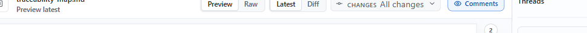

Commentary separates three choices: the content surface, clean document versus comparison, and the exact version or range.

| Control | Use it for |
| --- | --- |
| **Preview** | Read rendered Markdown or sandboxed static HTML |
| **Raw** | Inspect Markdown, HTML, YAML, or JSON source |
| **Document** | Read a clean current or historical snapshot |
| **Changes** | Compare a recommended range, PR update, commit, or custom range |
| **Docs preview** | Read a detected docs-framework route with nearby site navigation |
| **Present** | Show a clean rendered document or deck in a meeting-friendly view |

Switching Preview and Raw preserves the selected document version or comparison. Historical snapshots stay pinned when new updates arrive; return to current explicitly when ready. Changes may show all PR changes, the latest recorded update, an individual commit, or a custom range. For a custom range, select the newer endpoint and then the older baseline; Commentary normalizes comparison direction.

Version and comparison histories are newest first and bounded. Search appears for longer histories. If the exact historical content is unavailable, the review shows an unavailable state instead of substituting a different endpoint.

Use [Present] only when a simplified reading surface helps; use **Raw** when exact syntax or line wrapping matters. Raw mode supports word wrap. See [Markdown and HTML rendering](rendered-content.md).
