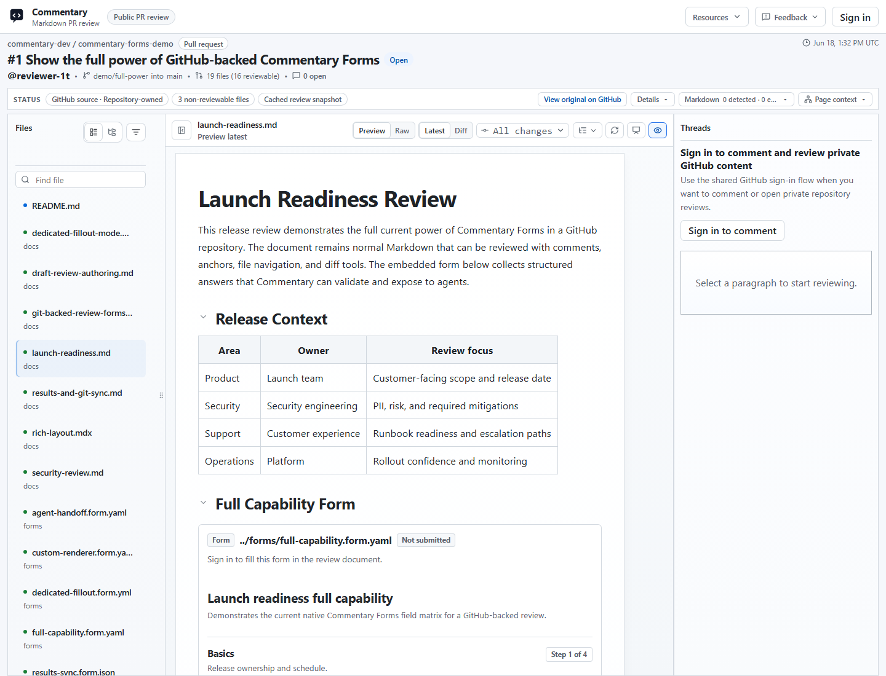

Use a Commentary Form when you need repeatable structured input such as launch readiness, security triage, migration checks, customer intake, or an evaluation rubric. Form responses are structured values; use review threads for discussion and polls for choices attached to a thread.

## Author a source-backed Form

Inspect the [public Forms example](https://commentary.dev/review/github/commentary-dev/commentary-forms-demo/pull/1?file=docs%2Flaunch-readiness.md)
to see a Form in its review context. Reading the example does not submit a response.

Create or edit a Form Contract in a Markdown/MDX source, a standalone `.form.yaml`, `.form.yml`, or `.form.json` file, static HTML, or Draft Review. The workspace discovers source-backed Forms and results; it is not a separate Form authoring editor.

Here is a minimal contract:

```yaml
commentaryForm: 1
id: release-readiness
title: Release readiness
description: Record the final release checks.
schema:
  type: object
  additionalProperties: false
  required: [reviewer, riskLevel]
  properties:
    reviewer:
      type: string
      title: Reviewer
      fieldKind: text
      minLength: 2
      maxLength: 80
    riskLevel:
      type: string
      title: Risk level
      fieldKind: dropdown
      enum: [low, medium, high]
    notes:
      type: string
      title: Notes
      fieldKind: textarea
      maxLength: 4000
submit:
  destinations:
    - kind: commentary
      enabled: true
```

With this contract, a participant sees a required Reviewer field, a required Risk level selector with Low/Medium/High choices, and optional Notes. Final submission returns field diagnostics if either required value is missing.

Validate the contract before asking participants to fill it in. The server validates final answers against the current contract; client-side checks only help users correct input sooner.

## Collect answers

1. Open the source-backed Form in the review surface and check its Preview and Raw views.
2. Use Review mode to inspect all questions without answering them, if the native renderer offers it.
3. Share the source review with the intended participants. Form submission requires sign-in by default, including on a public read-only PR.
4. For a dedicated response link, have an authorized owner create the link from the existing Form. Choose whether it accepts anonymous or authenticated submissions and revoke it when collection ends.
5. Participants submit one final response; repeat submissions are allowed unless the source or link configuration says otherwise.



## Review results and export

Result-list permission is separate from permission to fill a Form. Draft owners can see their draft Form results. PR and branch results require a trusted source write-permission check. Response-link results belong to the link owner by default. A submitter may be able to read their own submission without seeing the full collection.

Open permitted results, inspect validation state and source context, then export JSON, YAML, or CSV where supported. A read-only result-share link may expose a results collection to its configured audience. Submitted values are product data, not analytics events.

If you enable GitHub writeback, it uses a separate write-capable GitHub App; the normal read-only app does not write repository content. Preview the canonical path and payload before explicitly writing a result. For example, a Form at `forms/security-review.form.yaml` writes results under `forms/results/security-review/`.

## Expected result and recovery

The response is validated and attached to the exact source Form version. If final validation fails, use the returned field diagnostics to correct the response; do not treat a saved draft validation failure as a final submission. If a result list is unavailable, confirm you have result-list authority rather than only fill access.

For custom-branded UI, use the Forms SDK bridge inside an existing Live Preview Review. Commentary still owns the contract and final validation. See [Form authoring and permissions](../build/forms.md), [API/MCP automation](../reference/api.md), and [Live Preview SDK setup](../build/live-preview-sdk.md).
