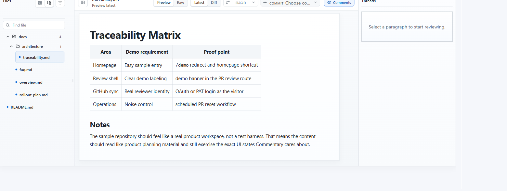

Use document review when an ADR, specification, README, static report, or generated page needs feedback before or outside a pull request.

## Prepare access

Try the [public customer-escalation runbook](https://commentary.dev/review/github/commentary-dev/commentary-demo-reviews/document?branch=demo%2Fbranch-markdown&file=runbooks%2Fcustomer-escalation.md).
Confirm the branch and file, then switch between Preview and Raw. This example
opens a branch document directly without creating a pull request.

For a public GitHub repository you can open a document read-only without an account. Sign in to comment or refresh. Private GitHub and Azure DevOps documents require a connected account with repository access.

## Open the right source

1. Copy a GitHub repository, branch, folder, Markdown/MDX file, or static HTML URL. For Azure DevOps, use a project-scoped repository, branch, folder, or file URL where possible.
2. Paste it into the [home page](https://commentary.dev/) and select **Open review**.
3. Confirm the branch and file shown in the review context. Use the navigator to move among supported documents.
4. Read in **Document** mode. Switch to **Changes** when you need to inspect a branch or commit change set. Select **Raw** for source syntax.
5. Add comments to rendered blocks or selected text after signing in.

Example artifact: open `docs/adr/004-cache-policy.md` on `feature/cache-policy`, then compare the selected branch with its recorded base. The expected result is the ADR rendered in Document mode, with a separate Changes view showing only the selected comparison; switching Raw preserves that range.

## What the conversation means

These are app-native threads attached to the repository document. There is no PR **Submit review** action, and comments do not create a commit or provider PR comment. Use a branch review for collaborative feedback, then make and submit the actual repository change through your normal Git workflow.

Use the personal progress control to record which files or sections you reviewed. You can resume without relying on a shared repository update timestamp.

## Expected result and next steps

The team gets a durable review surface before a PR exists. After the author updates the branch, refresh the document and re-read the relevant snapshot. If the work moves into a PR, open that PR to submit a provider review and synchronize eligible PR threads.

If a file is missing, verify the selected branch, repository permissions, and supported file type. For a file that exists only on your machine, create a [draft review](review-a-local-draft.md) instead.
