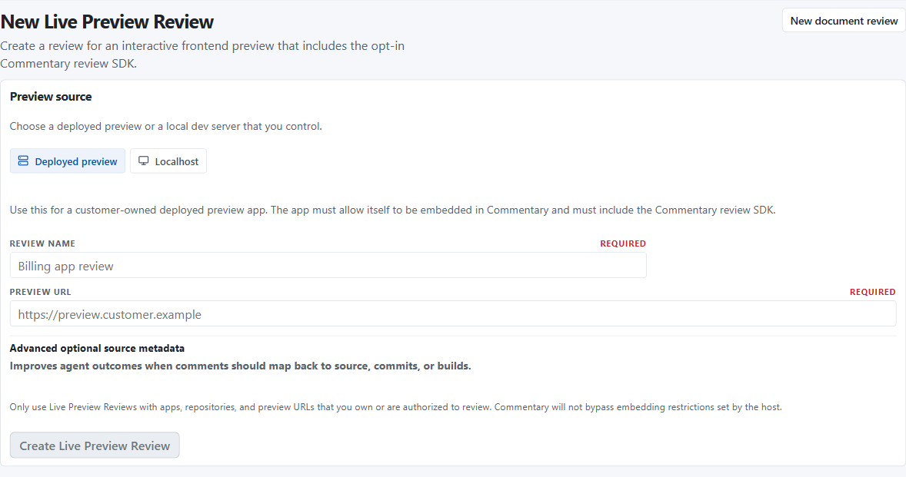
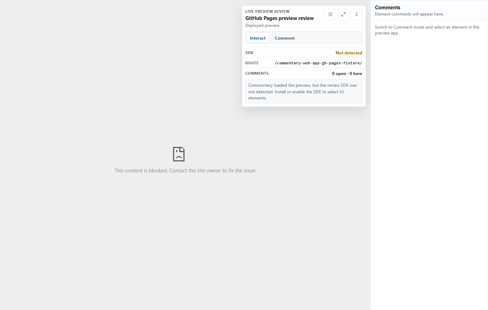

Use Live Preview Review for an app you own or are authorized to review. A working Review SDK lets reviewers select UI elements; screenshot feedback is available for framed previews without a usable SDK.

## Choose the preview target

- **Deployed preview:** use an HTTPS preview or staging URL. It can be shared with authorized reviewers. Embedded delivery requires the host to allow Commentary in `frame-ancestors`; new-tab delivery needs a compatible SDK overlay and `frame-src https://commentary.dev`.
- **Localhost:** use `localhost`, `127.0.0.1`, or `[::1]` while the app is running on your machine. The browser loads it locally; Commentary's cloud does not fetch it. Localhost reviews cannot be shared as working previews.

Private LAN addresses are rejected by default. Do not disable production security headers broadly to make a review work.

## Create the review

1. Sign in, select a workspace, and choose **New review → Live Preview**.
2. Select **Deployed preview** or **Localhost**, enter the URL, and add optional repository, branch, commit, deployment, or build metadata.
3. Choose Automatic, Inside Commentary, or New tab delivery when available, then create the review.
4. Open the generated review link. Use **Interact** to use the app normally and **Comment** to select elements.



## Enable element comments in your preview build

Install the published `@commentary-dev/review-sdk` package or load the supported CDN script only in preview/review builds. Set Commentary's parent origin and optional build metadata before loading the SDK:

```ts
if (import.meta.env.VITE_COMMENTARY_REVIEW === "true") {
  window.__COMMENTARY_PARENT_ORIGIN__ = "https://commentary.dev";
  window.__COMMENTARY_PARENT_ORIGINS__ = ["https://commentary.dev"];
  window.__COMMENTARY_COMMIT_SHA__ = import.meta.env.VITE_COMMIT_SHA;
  window.__COMMENTARY_BUILD_ID__ = import.meta.env.VITE_BUILD_ID;
  await import("@commentary-dev/review-sdk");
}
```

The Review SDK is a browser integration. Its npm package is available; the separate agent SDK is not a released npm package. Add `data-commentary-component` and `data-commentary-source` attributes where useful to make targets easier to identify.

## Leave a comment and share

Select **Comment**, point to the element, and write the concern. Commentary stores bounded selector and viewport metadata, not a DOM dump or raw app HTML. If no SDK is available, use the explicit screenshot capture flow to select a region; only the cropped review area is uploaded.

Share deployed HTTPS reviews with a signed link for anyone with the link or a specific GitHub user. Recipients sign in to claim full comment access. Localhost remains private to the local reviewer.

For example, a reviewer selects the “Save changes” button on a checkout preview and asks that its pending state be visible. The expected result is a thread with route and element summary in the comments pane. Selecting it later asks the SDK for a fresh target rectangle; if the element disappeared, the thread remains readable and its target is marked unavailable.



## Recover connection problems

- **SDK is disconnected:** reload the preview with the SDK enabled; try the offered new-tab or screenshot option.
- **Iframe is blank or blocked:** check the preview's `frame-ancestors` response policy. A timeout alone does not prove framing was blocked.
- **New tab is disconnected:** reopen from the original review. Launch handles expire after five minutes; a connected session is limited to two hours.
- **Target element moved or disappeared:** the thread remains readable; Commentary marks the target unavailable when it cannot be located in the current DOM.

Next: [SDK setup and limits](../build/live-preview-sdk.md) or [collect structured Form responses](collect-form-responses.md).
