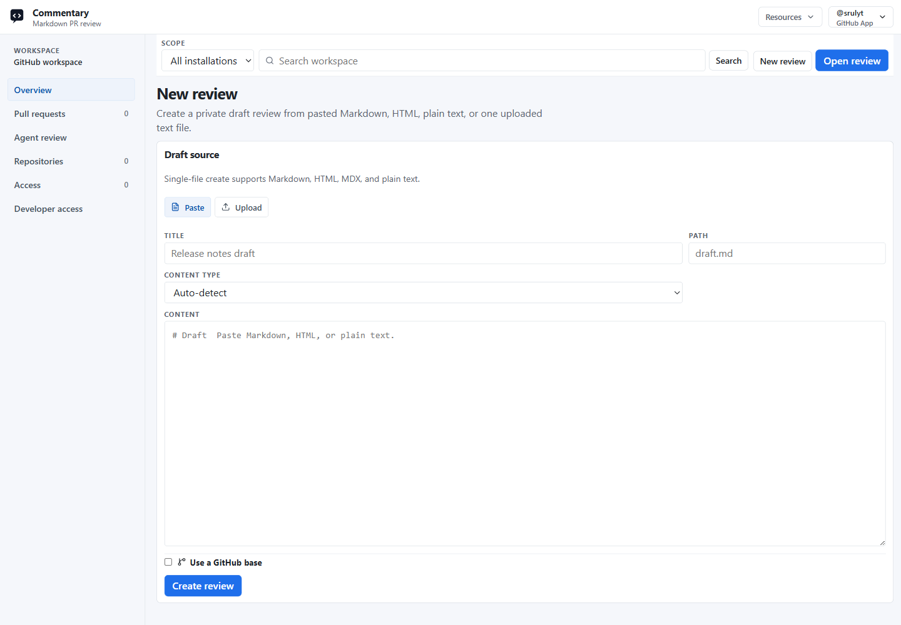

Use a Draft Review when the content is local, generated, or not ready for a repository branch. The files remain yours to edit; Commentary hosts immutable snapshots and app-native discussion.

## Create the review

1. Sign in and choose **New review → Document review** in the destination workspace.
2. Choose **Paste** for a short artifact or **Upload** for files. Supported text includes Markdown, MDX, HTML, and plain text; supported visual artifacts include images, SVG, and Mermaid source.
3. Add a title, inspect the detected format, and choose **Create review**.
4. Optionally attach a GitHub base when the draft relates to an existing file, branch, or commit. This records comparison context only; it does not create or write to a Git branch.



## Review and revise

1. Read the current revision in Preview. Use Raw for source details.
2. Signed-in reviewers can create threads on semantic blocks or selected text, reply, and resolve discussions.
3. Edit the local source using the review comments as guidance.
4. Open the draft and choose **Upload new revision**, or use the CLI below. Upload only changed files if useful: omitted files carry forward into the new immutable revision.
5. Re-read the current revision. Earlier revisions remain available but cannot receive new comments.

```bash
npx @commentary-dev/cli review ./docs/spec.md --title "Product spec"
npx @commentary-dev/cli sync --message "Address review comments"
npx @commentary-dev/cli comments --format markdown --open
```

Example artifact: `docs/spec.md` has a “Data retention” section and a reviewer asks for the deletion window and affected stores. After editing locally and syncing, the review shows the new current revision while the previous revision stays readable. The original thread remains available at its semantic anchor for follow-up.

The CLI requires Node.js 22 or newer. Version 0.3.0 of `@commentary-dev/cli` is the published package used by these commands. See [CLI setup](../build/cli-draft-reviews.md).

## Close the loop

When reviewers agree the text is ready, pull or download the reviewed content if Commentary is the desired source, then commit and push through your own Git credentials. Draft review does not create a branch, commit, pull request, or provider review comment.

Expected result: reviewers share a link to the same draft, comments remain in Commentary, and each edit creates a traceable immutable revision. If the first upload fails, check file type and size, then retry the upload; API and agent clients must send literal file content and cannot ask Commentary to read a local path.

Next: [reach a human decision](reach-a-human-decision.md) or [share the draft](../use/draft-reviews.md).

