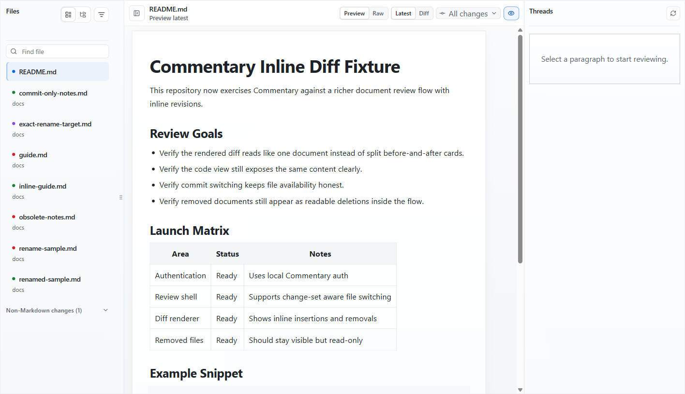
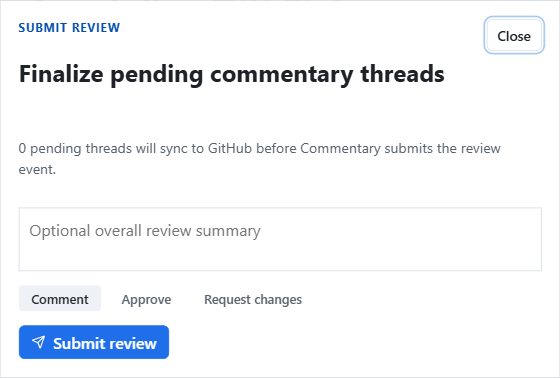

Use this workflow when the change is already in GitHub or Azure DevOps and reviewers need to understand prose, structured content, or rendered pages instead of scanning only line diffs.

## Before you begin

Try the [public launch-readiness PR](https://commentary.dev/review/github/commentary-dev/commentary-demo-reviews/pull/1?file=docs%2Flaunch-readiness.md) first.
Read the checklist, open Changes, and locate one sentence that needs a clearer
owner or acceptance condition. Reading is anonymous; commenting requires sign-in.

- Have the pull request URL.
- For a public GitHub PR, you can read without signing in. To comment, reply, refresh private content, or submit a review, sign in and confirm provider access.
- For private GitHub and Azure DevOps, connect the provider account that can read the repository.

For example, a PR that changes `docs/release-checklist.md` should open with the checklist rendered as a clean document. Selecting a commit comparison shows that commit's exact additions and removals; switching to Raw exposes the source while keeping the same comparison selected.

## Open and read the change

1. Paste the PR URL on the [Commentary home page](https://commentary.dev/) and choose **Open review**.
2. Begin in **Preview → Document**. A single Markdown file opens without a file navigator; a multi-file change shows a navigator that can switch between flat and folder views.
3. Select the changed document that matters to your review. Use the file filter when the PR is large.
4. Read the rendered content. Use **Raw** to inspect syntax or exact source; the selected document or comparison stays selected while changing surfaces.
5. Use **Changes** only to answer a concrete change question. Choose all PR changes, a recorded update, a commit, or a custom range. Commentary preserves the selected endpoints and does not silently widen an unavailable comparison.
6. Track reviewed files or sections with the progress control when you need to resume later.

## Start a focused conversation

1. Sign in, then select a rendered block or text range.
2. Write one actionable observation. Describe the risk or question and the decision the author needs to make.
3. Use a reply when the thread already covers the concern. Resolve or reopen threads as the conversation changes.
4. For a draft change, remember that the new thread is pending inside Commentary until provider review submission.

Example comment: on a release note that says “deploy after approval,” ask whether the rollout owner and rollback condition should be named. The expected result is one anchored thread beside that rendered sentence, marked pending until review submission.

For structured votes or a formal proposal decision, use [Polls and Consensus](reach-a-human-decision.md). Provider reactions are not decision records.

## Submit the review

When ready, select **Submit review**. Review the count of pending threads that still need synchronization, then choose **Comment**, **Approve**, or **Request changes** and optionally add an overall summary. Submit only when the review state accurately represents your recommendation.

The selected event is sent through the provider review workflow. If submission fails, keep the page open, read the reported synchronization state, and retry only after the pending items are clear; do not assume a provider event succeeded because local threads are visible.

## Expected result

Reviewers have a readable rendered artifact, comments are anchored to content, and a submitted PR review carries the chosen provider outcome. Commentary threads remain available alongside synchronized provider comments.

## Common recovery

- **Repository is inaccessible:** sign in and check the provider installation or organization permission.
- **A comment is not in GitHub yet:** it may be pending; submit the review to send the staged review work.
- **A change range is unavailable:** select a valid recorded commit/update or return to the current document; do not interpret a substituted range.
- **Merged PR:** keep the historical PR view for its conversations, or follow the offered redirect to a target-branch review filtered to files from that PR.

Next: [Review a branch document](review-a-branch-document.md), [understand review modes](../use/review-modes.md), or [track review progress](../use/review-progress.md).
